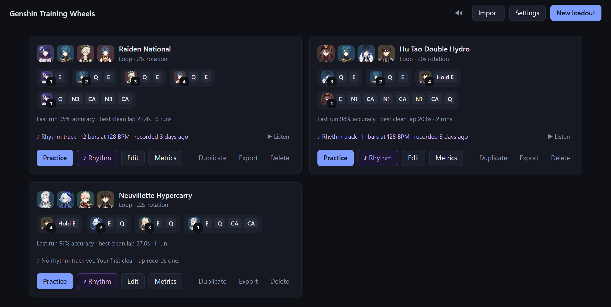
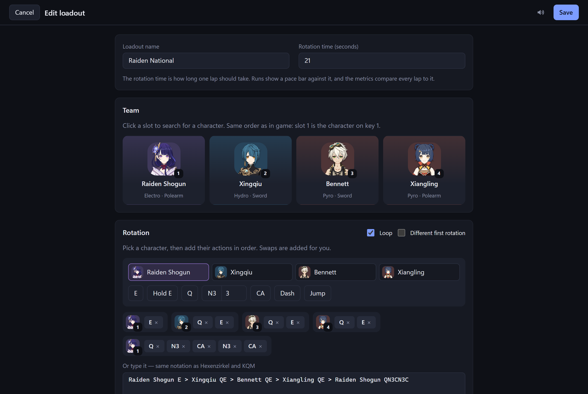
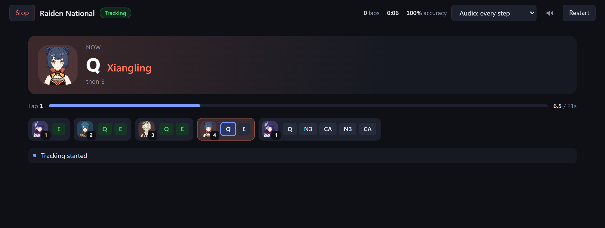
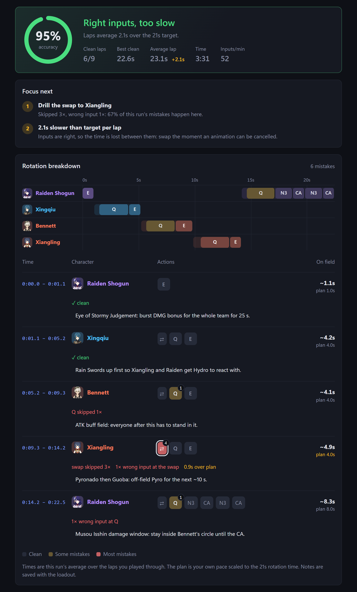
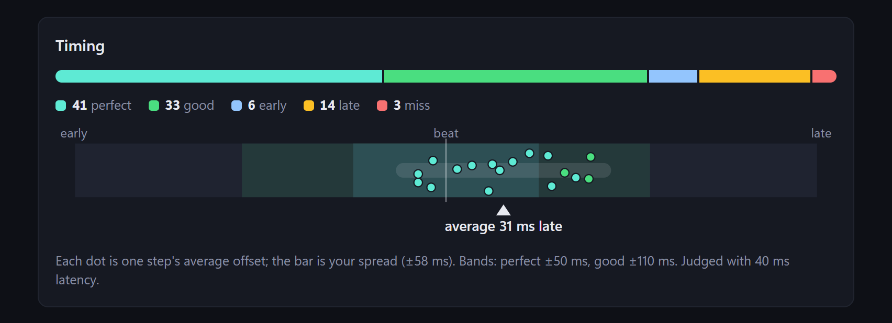
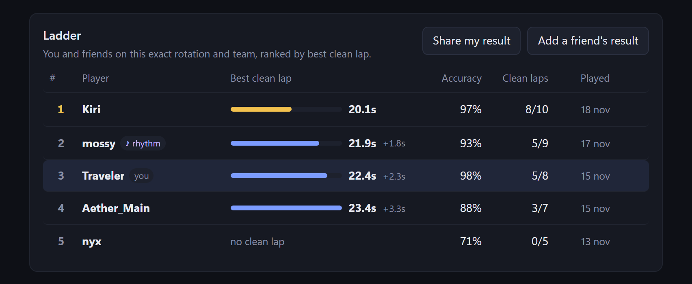

# Genshin Training Wheels

**Learn a Genshin Impact team rotation by playing it.** Describe your team and its rotation
once. While you play, the app listens to your keys, follows where you are in the rotation and
cues the next move through your headphones, early enough to react to. Afterwards it tells you
what went wrong, where, and what to work on next. Once the rotation is in your hands, turn the
cues down and ride without them.

<p align="center">
  
</p>

It only reads your keyboard and mouse. It does not read the game's memory or screen, inject
anything, or send any input.

- **Any rotation.** Paste it in the notation Hexenzirkel and KQM use, or import a gcsim or
  Genshin Optimizer config.
- **Cues that lead you.** A distinct sound per key, played ahead of time, that adapts to your
  own pace.
- **Rhythm mode.** Your own clean lap becomes a backing track, and every step is judged on the
  beat.
- **Feedback that says what to fix.** A verdict, the three things to work on next, and the
  rotation broken down turn by turn.
- **Ladders with friends.** Share your best run as a code and race friends on the same rotation.

**[Download for Windows →](../../releases)**

## Install

Download `Genshin.Training.Wheels_…_x64-setup.exe` from the [Releases](../../releases) page and
run it (Windows 10/11, 64-bit). Newer versions install over older ones and keep your loadouts,
runs and settings.

The app is free and **not code-signed**, so Windows does not know the publisher:

- **SmartScreen** shows "Windows protected your PC". Choose *More info → Run anyway*.
- **Smart App Control** (Windows 11, only if it is switched on) blocks unsigned apps outright
  and offers no "run anyway". The app cannot start while it is on; you can check it under
  Windows Security → App & browser control → Smart App Control.

For tracking in game, use **Restart as administrator** on the home screen: see
[Things to know](#things-to-know).

## A tour

### 1. Set up a loadout

Four characters in party order, the rotation, and how long one lap should take. Build it with
the buttons or type it:

```
Raiden E > Xingqiu QE > Bennett QE > Xiangling QE > Raiden Q N3C N3C
Rotation time: 21 s
```

<p align="center">
  
</p>

Characters by name, nickname or slot number, picked from a searchable roster with portraits.
**Import** on the home screen also reads gcsim configs and Genshin Optimizer target configs
(what Hexenzirkel's "Export rotation" downloads). **Export** writes the rotation text, a gcsim
action list or a full loadout.

<details>
<summary>Notation reference</summary>

- Characters: name, nickname or slot number (`1`–`4`).
- Actions: `E`, `hE` (hold), `Q`, `N1`–`N9`, `C` / `CA`, `D` (dash), `J` (jump), `P` (plunge).
- `2x[…]` repeats a group. Swaps are implied.
- Lines starting with `1st rotation:` and `2nd onwards:` give a first rotation (an opener) that
  differs from the rest.
- gcsim: the team comes from the `char` lines and the loop from the first `while`/`for`.

</details>

### 2. Practise

Press **Start**, switch to the game and play. The tutor knows who is on field from your swap
keys, reads Alt+number as "swap and burst", tells a tap from a hold and counts attacks. The cue
for each step plays about half a second before it is due, and a pace bar shows the lap against
your rotation time.

<p align="center">
  
</p>

Skip a step and it carries on from where you are. Lose the thread and it waits until you start
any character's turn again. Stop pressing keys and the run pauses without penalty. **F10**
stops the run, **F9** restarts it.

### 3. See what to fix

Every run ends with a recap. A verdict and the three things worth working on come first. Below
them, a **timeline** gives each character a lane: every action sits where you pressed it, as
wide as it took, tinted by how often it went wrong. Under it the rotation is laid out **turn by
turn**: when each character's turn starts and ends, time on field against your plan, and a note
you can write for each turn, such as what it buffs or what it sets up.

<p align="center">
  
</p>

**Metrics** on a loadout keeps every run: lap times, accuracy and field time per character, and
trends over time.

### 4. Play it on the beat

Start a loadout with **♪ Rhythm** and the rotation becomes music. Your own clean lap, snapped to
a 128 BPM grid, plays as cues over a backing band, and the music does not wait for you. Every
step is graded **perfect** (±50 ms), **good** (±110 ms), **early**, **late** or **miss**, and
the recap shows whether you rush or drag, and on which steps.

<p align="center">
  
</p>

A loadout records its track from its first clean lap, in either mode. Measure your setup's
delay once under Settings → **Calibrate by tapping along**: headphones and keyboards each add
their own, and Bluetooth can add 150 ms or more.

### 5. Race your friends

Each loadout has a ladder, ranked by best clean lap. **Share my result** gives you a code to
paste in chat. A friend pastes it with **Add a friend's result**, or with **Import** on the
home screen. The code carries the loadout too, so a friend who does not have it gets it from
your code. Results only count on exactly the same rotation and team.

<p align="center">
  
</p>

Codes are checked against copy-and-paste damage but not signed: they are for comparing with
friends, not a cheat-proof leaderboard.

## Details

### What counts as a mistake

Skills, bursts and swaps are judged strictly. Attacks, dashes and jumps are not: click counts
and movement cannot be verified from input alone, so extra or missing ones never count against
you. Mashing a key, or swapping back to the right character, is not an error either.

After several wrong inputs in a row the tutor declares you **off track**: it stops judging and
picks you up again when you start any character's turn (or, optionally, only when you restart
from step one).

### Audio cues

Cues play **ahead of time** (500 ms by default), because a cue that sounds at the instant a key
is due arrives too late to act on. A soft build-up rises from the cue to the moment to press.
The tutor starts from typical timings and then learns the pace of your own clean steps, per
loadout. Settings → **Cue sound** switches every cue to a voice that calls the key instead, and
Settings → Sound guide plays them all.

<details>
<summary>Practice-mode sounds</summary>

| Cue | Sound |
| --- | --- |
| Swap to slot N | Arpeggio climbing N notes |
| Skill / hold skill | Rising "bloop" / the same, sustained |
| Burst | Fast high trill ending on a sparkle |
| Attacks / charged | One "tok" per hit / tok and a low drop |
| Dash / jump | Breath of noise / upward chirp |

</details>

<details>
<summary>Rhythm-mode sounds and music styles</summary>

| Key | Distinct sound (default) | Voice |
| --- | --- | --- |
| 1 / 2 / 3 / 4 | Cold detuned stab / square pluck / glass bell / metallic ping, rising | "one" … "four" |
| e / hold E | Cowbell / cowbell and a rising whistle | "E" / a long, rising "Eee" |
| q | Impact (sub boom and noise burst) with a crash | "Q" over the impact |
| n / c | Woodblock tick per click / snare crack over a thump | "N" (then ticks) / "C" |
| dash / jump | Noise whoosh upwards / rising chirp | "dash" / "jump" |

The voice is synthesised from vowel resonances, not a speech engine, so it lands exactly on the
beat.

The band comes in five styles. **Runway techno** (the default) is fashion-show electroclash:
dry four-on-the-floor, rolling acid bass, cold stabs, string builds and supersaw lifts in a
32-bar cycle. Lo-fi hip-hop, funk / disco, house and rock / pop are played from real drummers'
grooves. Pick one in Settings, in the session's top bar or in the Music lab (Settings → Open the
Music lab), where grooves, fills and band levels can be tuned. The speaker icon in every top
bar sets master, cue and music volume.

Miss four steps in a row and the track re-aligns to your next step. A short sound tells you
each judgement; Settings can turn it off.

</details>

## Things to know

- **Administrator rights.** Genshin Impact runs elevated, and Windows hides input from
  non-elevated apps while an elevated window has focus. The app starts normally and offers a
  "Restart as administrator" button for in-game tracking.
- **Antivirus and SmartScreen.** The app uses Windows Raw Input (a read-only copy of input
  events) rather than a keyboard hook, listens only while a run is active, makes no network
  connections and never writes keystrokes to disk.
- **Game terms.** This is an unofficial third-party tool. It does not interact with the game
  client, but HoYoverse's terms do not approve third-party tools in general; use it at your own
  discretion.
- **Windowed or borderless** is needed to see the compact overlay; audio cues work in any mode.
- Input-only tracking cannot see cooldowns, energy or a swap the game refused.
- The character roster and portraits ship with the app; nothing is downloaded at run time.

## Development

Requires Node.js, Rust and the Microsoft C++ Build Tools. Smart App Control also blocks the
helper programs Rust generates while compiling, so the desktop app only builds locally with it
switched off; the browser UI and the tests are not affected.

```bash
npm install
npm test            # tracker, interpreter, cues, metrics, ladders
npm run dev         # UI in a browser (keys only while the page has focus)
npm run tauri dev   # the desktop app
npm run tauri build # installer in src-tauri/target/release/bundle
npm run screenshots # README screenshots, with `npm run dev` running
```

- `src/lib/interpreter.ts`: raw input to game actions
- `src/lib/engine.ts`: rotation tracking, skips, off-track and resync
- `src/lib/cues.ts`, `src/lib/timing.ts`, `src/lib/audio.ts`: when to cue, learned pace, sound
- `src/lib/metrics.ts`, `src/lib/coach.ts`, `src/lib/breakdown.ts`: run metrics, the verdict and
  tips, the turn-by-turn breakdown
- `src/lib/ladder.ts`: result codes and ladders
- `src/lib/music/`: rhythm mode: lap to track (`arrange.ts`), band (`band.ts`), cues
  (`cuelayer.ts`, `voice.ts`), playback (`player.ts`)
- `src-tauri/src/capture.rs`: Raw Input listener

`scripts/update-roster.mjs` regenerates the character roster and portraits.
`src/lib/music/grooves.json` is generated by `scripts/extract-grooves.mjs` from the Groove MIDI
Dataset; the script's header says how to fetch it. `scripts/screenshots.mjs` drives headless
Edge or Chrome over a demo profile to take the screenshots above.

Releases are built by GitHub Actions when a `v*` tag is pushed.

## Credits

- Drum grooves: excerpts of the [Groove MIDI Dataset](https://magenta.tensorflow.org/datasets/groove)
  by Google LLC — Jon Gillick, Adam Roberts, Jesse Engel, Douglas Eck and David Bamman,
  "Learning to Groove with Inverse Sequence Transformations", ICML 2019 — licensed
  [CC BY 4.0](https://creativecommons.org/licenses/by/4.0/). Cut into loops and fills, aligned to
  the beat and re-synthesised; no recordings are included.
- Audio engine: [Tone.js](https://tonejs.github.io/) (MIT).

Not affiliated with HoYoverse. Character portraits and names belong to HoYoverse.
